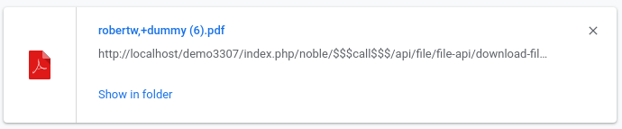
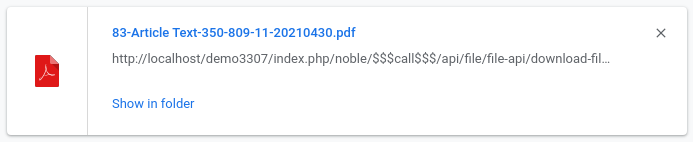
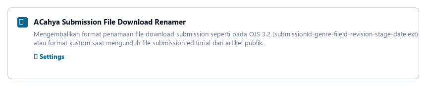
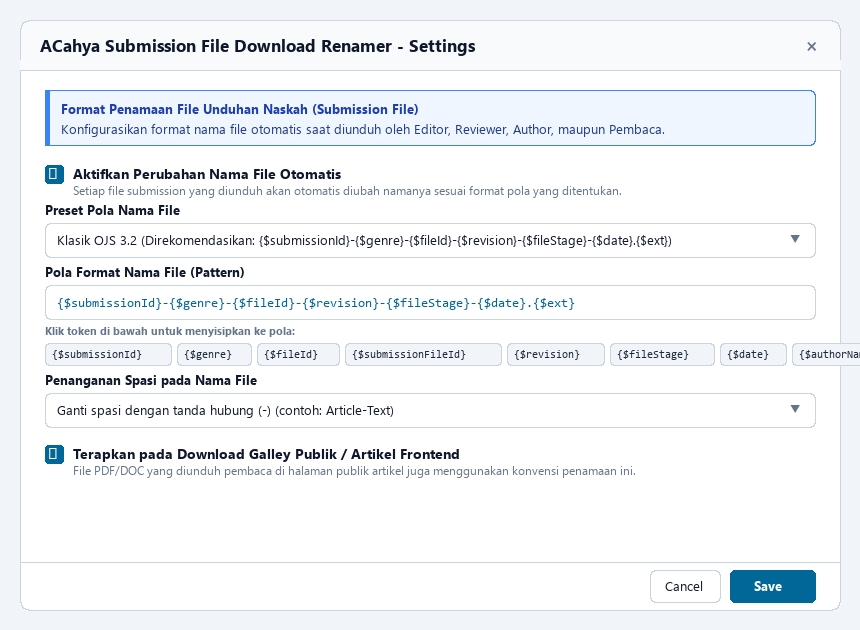

# ACahya Submission File Download Renamer (`ACahyaRenameDl`)

Plugin generic untuk **Open Journal Systems (OJS)** yang mengembalikan dan memformat nama file saat mengunduh file submission (seperti pada konvensi klasik **OJS 3.2**), terinspirasi dari referensi plugin `ojtFileDownload` namun telah dioptimalkan secara modern untuk kompatibilitas penuh dengan **OJS 3.3.x, 3.4.x, dan 3.5.x**.

---

## 📸 Tangkapan Layar (Screenshots)

### 1. Perbandingan Sebelum & Sesudah Saat Unduh File

#### ❌ Sebelum Menggunakan Plugin (OJS Bawaan):
Nama file sering kali hanya berupa teks generik yang diunggah author atau hash acak sistem internal tanpa identitas submission:



#### ✅ Sesudah Menggunakan Plugin (Konvensi OJS 3.2 Terstruktur):
Nama file otomatis diformat dengan ID Submission, Genre, File ID, Revisi, File Stage, dan Tanggal:



---

### 2. Tampilan Plugin di Dashboard OJS
Plugin muncul pada daftar **Installed Plugins > Generic Plugins** dengan tombol toggle aktivasi langsung dan menu **Settings**:



---

### 3. Modal Pengaturan Format Nama File (Settings)
Anda dapat memilih preset konvensi OJS 3.2, format nama asli, pola kustom dengan token interaktif, serta penanganan spasi dan download publik:



---

## 📌 Latar Belakang Masalah

Pada versi OJS yang lebih baru (OJS 3.3 ke atas, khususnya 3.4 dan 3.5):
1. **Nama File Acak/Generik:** Saat editor atau reviewer mengunduh file submission dari workflow editorial, nama file sering kali berupa nama generik yang diunggah author (misal `manuscript.docx`, `artikel.pdf`) atau hash sistem internal (misal `6a66126545f96.doc`).
2. **Kesulitan Pengelolaan:** Jika editor mengunduh puluhan file submission, semua file memiliki nama yang mirip atau identik tanpa ID submission, nama bidang/genre, revisi, atau tanggal, sehingga sangat membingungkan proses editorial.
3. **Konvensi Klasik OJS 3.2:** Pada OJS 3.2, setiap file yang diunduh secara default memiliki format terstruktur:
   ```text
   [submissionId]-[genre]-[fileId]-[revision]-[fileStage]-[YYYYMMDD].[ext]
   ```
   Contoh: `2630-Article-Text-15837-17049-2-20260726.doc`
4. **Keterbatasan Plugin Lama (`ojtFileDownload`):** Plugin lama `ojtFileDownload` hanya dibuat untuk OJS 3.3.x dan menggunakan dependensi lawas (`$fileService->fs->getSize()`, `Services::get('submissionFile')`, constructor `new PKPFileService()`), sehingga mengalami crash `Fatal error` pada OJS 3.4 dan 3.5 yang menggunakan Flysystem v3 dan Laravel container.

---

## ✨ Fitur Unggulan `ACahyaRenameDl`

* **Plug-and-Play (Langsung Aktif):** Tanpa perlu konfigurasi awal apa pun, plugin langsung aktif dan memformat nama file download submission sesuai standar OJS 3.2.
* **Kompatibel OJS 3.3, 3.4, & 3.5:** Menggunakan hook modern `File::formatFilename` dan `File::download` yang aman terhadap API Flysystem v3 (`fileSize()`, `readStream()`) dan facade database PKP.
* **Modal Pengaturan Interaktif:** Dilengkapi menu *Settings* di dashboard OJS (*Website Settings > Plugins*) untuk menyesuaikan pola nama file.
* **Pilihan Preset Format:**
  * **OJS 3.2 Klasik (Default):** `{$submissionId}-{$genre}-{$fileId}-{$revision}-{$fileStage}-{$date}.{$ext}`
  * **ID Submission + Nama Asli:** `{$submissionId}-{$originalName}.{$ext}`
  * **ID Submission + Genre + Nama Asli:** `{$submissionId}-{$genre}-{$originalName}.{$ext}`
  * **ID Submission + Author + Genre + Tanggal:** `{$submissionId}-{$authorName}-{$genre}-{$date}.{$ext}`
  * **Pola Kustom:** Pengguna bebas menyusun pola sesuai kebutuhan jurnal.
* **Pembersihan Spasi & Karakter Ilegal:** Opsi mengganti spasi dengan tanda hubung (`-`), garis bawah (`_`), atau mempertahankan spasi, serta sanitasi karakter bermasalah agar aman di semua sistem operasi (Windows, Linux, macOS).
* **Mendukung Download Satuan & Arsip ZIP:** File di dalam unduhan massal (*Download All Files* sebagai ZIP) otomatis menggunakan nama baru.
* **Perlindungan Double-Blind Review:** Nama author otomatis disamarkan (anonymized) jika file diunduh dalam mode telaah sejawat anonim ganda (*double-blind peer review*).
* **Pilihan Galley Publik:** Opsi fleksibel untuk menerapkan format penamaan pada file publik yang diunduh pembaca di halaman frontend artikel.

---

## 🏷️ Daftar Token Variabel yang Didukung

Anda dapat menggunakan variabel token berikut pada pola nama file:

| Token | Keterangan | Contoh Nilai |
|---|---|---|
| `{$submissionId}` | ID artikel / submission | `2630` |
| `{$genre}` | Jenis file / Genre komponen naskah | `Article-Text` |
| `{$fileId}` | ID unik file di database | `15837` |
| `{$submissionFileId}` | ID entri submission file | `17285` |
| `{$revision}` | Nomor revisi naskah | `1`, `2` |
| `{$fileStage}` | Kode tahap workflow editorial (2=Submission, 4=Review, 10=Galley) | `2` |
| `{$date}` | Tanggal pembuatan/unggah file (`YYYYMMDD`) | `20260726` |
| `{$originalName}` | Nama asli file sebelum diganti hash | `Manuscript_Jurnal` |
| `{$authorName}` | Nama belakang/lengkap author utama | `Rici` |
| `{$ext}` | Ekstensi file | `doc`, `pdf`, `docx` |

---

## 🚀 Panduan Instalasi

1. Pastikan folder plugin diletakkan pada direktori:
   ```text
   plugins/generic/ACahyaRenameDl/
   ```
2. Struktur folder plugin:
   ```text
   plugins/generic/ACahyaRenameDl/
   ├── ACahyaRenameDlPlugin.php
   ├── index.php
   ├── version.xml
   ├── README.md
   ├── images/
   │   ├── download_before.png
   │   ├── download_after.png
   │   ├── plugin_list.png
   │   └── settings_modal.png
   ├── classes/
   │   └── ACahyaRenameDlSettingsForm.php
   ├── templates/
   │   └── settings.tpl
   └── locale/
       ├── en/
       │   └── locale.po
       └── id/
           └── locale.po
   ```
3. Buka Dashboard OJS Anda:
   * Masuk sebagai **Journal Manager** atau **Administrator**.
   * Buka menu **Settings > Website > Plugins > Installed Plugins**.
   * Cari grup **Generic Plugins** dan temukan **ACahya Submission File Download Renamer**.
   * Pastikan checkbox aktif (centang).
4. Klik tombol panah bawah di samping plugin, lalu pilih **Settings** jika ingin mengubah format nama file.
5. Klik **Save**. Pengaturan langsung diterapkan seketika tanpa perlu restart server!

---

## 📜 Lisensi & Pembuat

* **Author:** ACahya
* **Lisensi:** GNU General Public License v3.0 (GPL-3.0)
* **Website / Repositori:** Open Journal Systems Plugins
